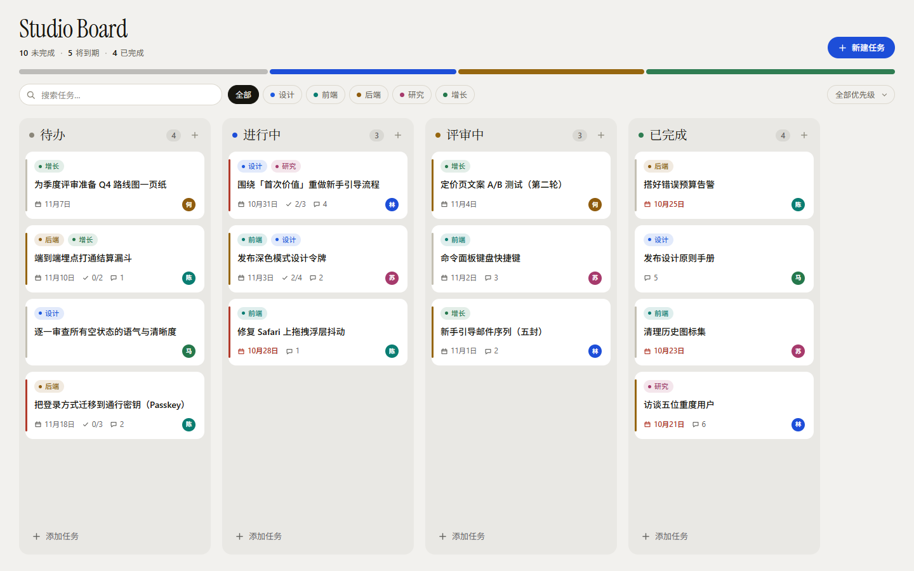
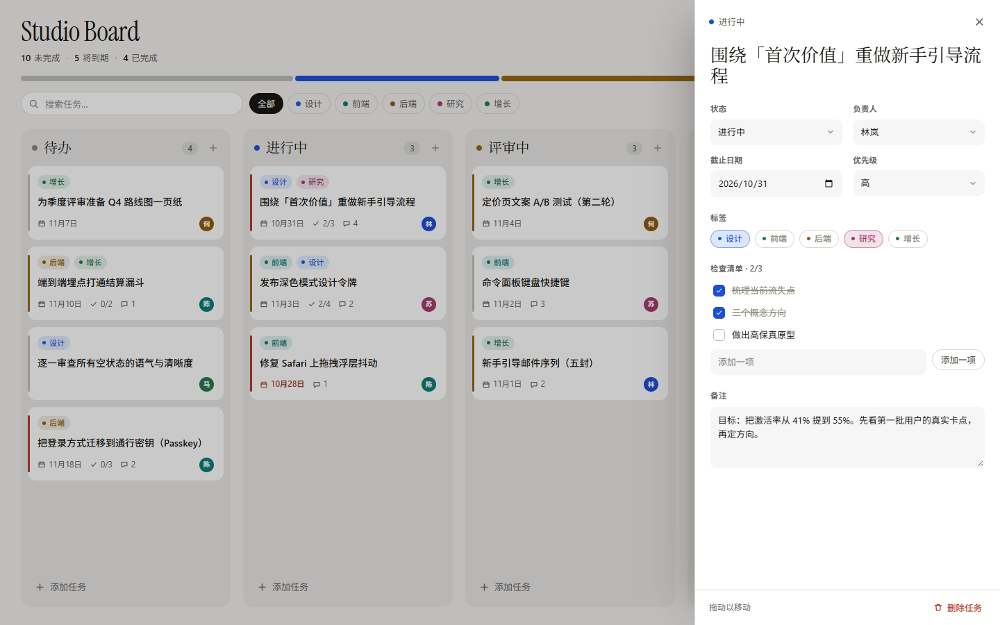
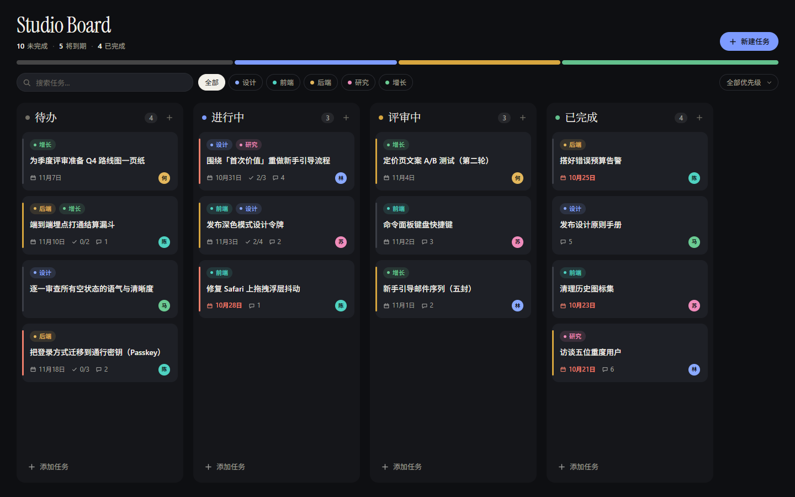
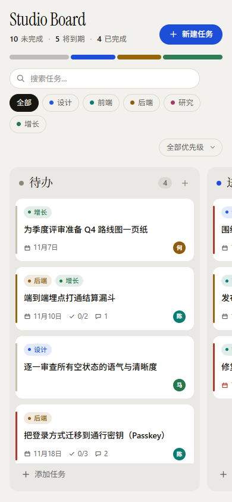

# dsh-task-board

> DeepSeek Harness 的 AI 任务看板插件：每个工作区一块板，拖拽流转，支持任务规格、评审泳道与人工签收。



## 功能

- **侧栏入口 + 主面板**：左侧栏新增「看板」图标，点击切换到看板页面。
- **每个工作区一块板**：看板按 workspaceId 隔离，顶部项目切换器可切换工作区。
- **五条泳道**：待办 / 进行中 / AI 评审 / 待签收 / 已完成；卡片带状态徽标、轮次、执行模型、PR 号。
- **拖拽流转**：鼠标与触控拖拽，抬起浮层、目标泳道高亮、落位缺口；键盘 `Alt+←/→` 换栏，`Esc` 取消。
- **任务规格**：验收标准、执行模型、评审模型、预算（轮数 / token / 分钟）、基线（HEAD 或分支 + 忽略未提交改动）。
- **详情抽屉**：标题、状态、负责人、截止日期、优先级、标签、检查清单、备注、删除。
- **搜索与筛选**：搜索、标签筛选、优先级筛选，统计行实时更新。
- **「需要你处理」收件箱**：跨列聚合待回答、待批准、待签字、受阻、失败。
- **人工签收**：待签收卡片可在抽屉里「通过签字 / 打回返工」。
- **Host 持久化**：看板数据由 Host 侧写入 `$DSH_HOME/task-board/<workspaceId>.json`，刷新和重启不丢。







## 安装

要求：**DSH >= 0.2.0 < 0.3.0**，Node >= 22。当前只通过 GitHub 分发。

### 方式一：Web UI（推荐）

1. 打开 DSH Web，左侧栏进入 **Plugins**；
2. 点 **Add plugin**；
3. 粘贴下面的 spec：

```
github:OWNER/dsh-task-board
```

4. 点 **Install**，完成后点 **Enable now**。

### 方式二：命令行

```bash
dsh plugin --profile web add github:OWNER/dsh-task-board
```

固定版本（推荐，避免上游变动）：

```bash
dsh plugin --profile web add github:OWNER/dsh-task-board#v0.1.0
```

安装后重启 `dsh web`（或依赖 HMR 生效），左侧栏会出现「看板」入口。

### 升级 / 卸载

```bash
# 升级：先移除再安装新 tag
dsh plugin --profile web remove dsh-task-board
dsh plugin --profile web add github:OWNER/dsh-task-board#v0.2.0

# 卸载
dsh plugin --profile web remove dsh-task-board
```

> Git 安装的插件不会出现在 Plugins 页的「Versions / Update」列表里，升级需要按上面的方式重装。

## 使用

- 顶部项目切换器选择工作区；每个工作区第一次打开会懒创建一块空板。
- 点「新建」或按 `N` 创建任务；`/` 聚焦搜索；`Esc` 关闭抽屉。
- 拖入「进行中」会调用 Host 的 `/task-board-api/start`：校验 Git 仓库、必要时创建任务工作树，并（开启自动执行时）创建执行会话。
- 看板本身不要求工作区是 Git 仓库；只有「执行」相关动作需要。

## 数据与隐私

- 看板数据保存在 `$DSH_HOME/task-board/<workspaceId>.json`，只在本机。
- 插件不会上传任何数据；网络请求只发生在你主动触发模型执行时。
- `/task-board-api/git` 只允许读取已注册工作区内的路径，工作区外返回 403。

## 开发

纯 JavaScript，无构建步骤：

```bash
node --check index.js
node --check client.js
```

本地联调：

```bash
# 1) 建一个独立 dev profile（复制官方 web 模板）
dsh --profile kanban-dev --from-default-profile web --dump-config

# 2) 把本仓库链接进去
dsh plugin --profile kanban-dev add /absolute/path/to/dsh-task-board

# 3) 起独立实例
dsh --profile kanban-dev --port 3081
```

修改 `client.js` 后刷新页面；修改 `index.js` 后重启 dev 实例。

## 状态

- ✅ 每工作区看板、五泳道、拖拽、任务表单、收件箱、人工签收、Host 持久化
- ✅ `/task-board-api`：workspaces / git 探测 / board 读写 / worktree 启动
- 🚧 AI 执行会话与评审回环（P1）：执行 → 评审 → 打回 / 通过 → PR → 合并

## License

[MIT](LICENSE)
