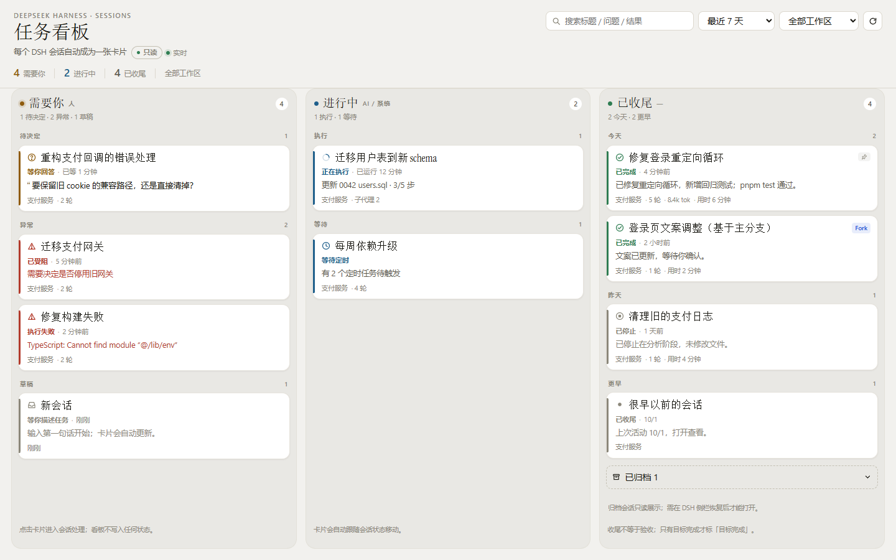
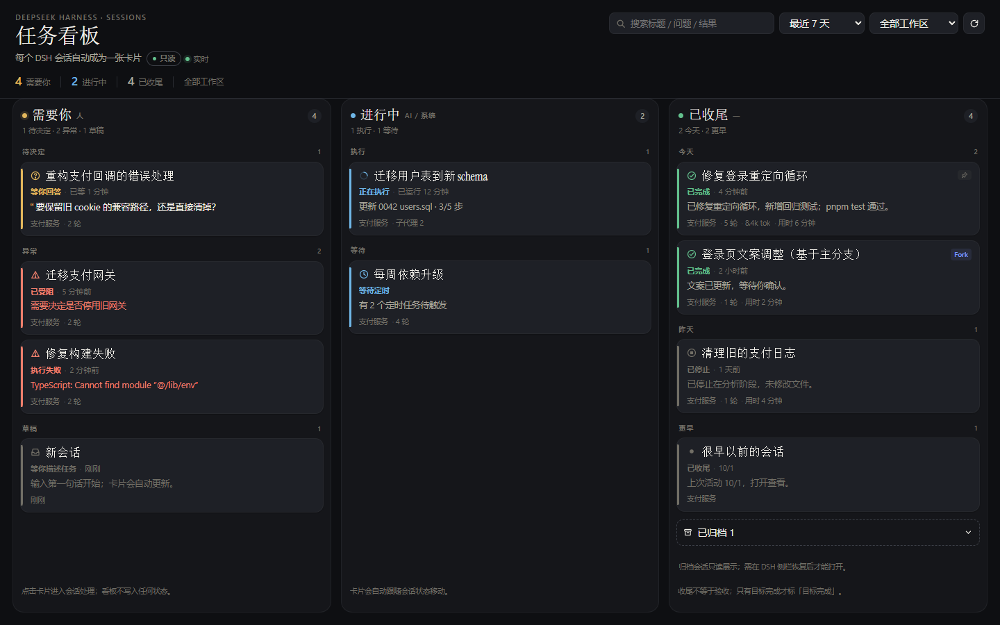
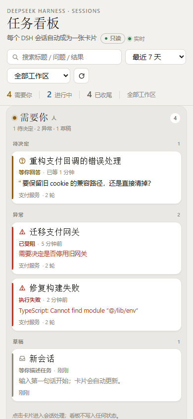

# dsh-task-board

> DeepSeek Harness 的只读会话看板：每个 DSH 会话自动成为一张卡片，按「需要你 / 进行中 / 已收尾」
> 三条泳道分诊。不建任务、不写状态、不拖拽；点击卡片进入会话处理。



## 它是什么

- **会话即卡片**：DSH 里新建一个会话，看板就出现一张卡；`sessionId` 是唯一主键，没有第二套任务库。
- **三条泳道**：需要你（人阻塞）、进行中（AI / 系统在推进）、已收尾（本轮已交回）。
- **标题跟随**：启用 `dsh-experimental-session-titles-bundle` 后，标题随主要任务变化；未启用时按首条
  消息显示，并在看板底部提示。
- **只读**：没有新建 / 编辑 / 拖拽 / 启动 / 重试 / 审批 / 签字；只做读取、筛选、打开会话。
- **低噪音**：子代理不出卡、归档折叠、空白只显示当前会话；已收尾只展开近期回执，历史默认收起。
- **先画后补**：先用本地会话行即时出卡，Host 快照和 SSE 随后补上问题 / 步骤 / 结果；不再等整包构建。

## 卡片上有什么

| 泳道 | 第二行 | 第三行（证据） |
| --- | --- | --- |
| **需要你** | 等你回答 / 等你批准 / 计划待审 / 执行失败 / 已中断 / 输出超限 | 问题原文、审批动作 + 原因、计划摘要、错误一句话 |
| **进行中** | 正在执行 / 子代理运行中 / 后台任务 / 等待定时 | 当前 todo 或工具步骤 + 进度；没有步骤时显示已运行时间 |
| **已收尾** | 已完成 / 已停止 / 目标完成 / 已归档 | 最后回复预览；没有文字时写「本轮无文字结论」 |

- 时间分别显示「已等 / 已运行 / 完成于」；超过 24 小时改用日期。
- 角标最多两个：`新结果`、`新指令`、`任务已更新`、`Fork`、`需迁移`。
- 标题变化不换泳道、不重排；`已收尾` 不等于验收，只有目标完成才标「目标完成」。



## 使用

1. 左侧栏点「看板」。
2. 顶部按标题 / 问题 / 结果搜索，按最近 7 / 30 / 90 天或工作区筛选。
3. 点卡片进入对应 DSH 会话；归档卡需先在侧栏恢复。
4. 已收尾列默认显示「新结果 / 今天 / 昨天」，更早与未读取的旧会话收进「历史 N 个会话」，展开后按 20 张加载。
5. 「已归档 N」在已收尾列底部，按需展开，只读展示。



## 安装

要求：**DSH >= 0.2.0 < 0.3.0**，Node >= 22。当前只通过 GitHub 分发。

### Web UI（推荐）

1. 打开 DSH Web，左侧栏进入 **Plugins**；
2. 点 **Add plugin**；
3. 粘贴：

```
github:a285292107s/dsh-task-board
```

4. 点 **Install**，完成后点 **Enable now**。

### 命令行

```bash
dsh plugin --profile web add github:a285292107s/dsh-task-board
```

固定版本：

```bash
dsh plugin --profile web add github:a285292107s/dsh-task-board#v0.3.0
```

安装后重启 `dsh web`（或依赖 HMR 生效），左侧栏出现「看板」。

### 升级 / 卸载

```bash
dsh plugin --profile web remove dsh-task-board
dsh plugin --profile web add github:a285292107s/dsh-task-board#v0.3.0
dsh plugin --profile web remove dsh-task-board   # 卸载
```

> Git 安装的插件不会出现在 Plugins 页的「Versions / Update」列表里，升级需要先移除再安装。

## 数据与隐私

- 看板**不落盘**：只读取 DSH 的会话、标题、投影与工作区注册表；没有任务库、审计文件或第二套状态。
- Host 只保留只读接口：`GET /task-board-api/cards`、`GET /task-board-api/archived`、
  `GET /task-board-api/events`、`GET /task-board-api/health`；没有写入路由。
- 旧的 `$DSH_HOME/task-board/*.json`、`*.audit.jsonl` 不再读取、不迁移、不删除。
- 标题、问题、回复属于会话内容；插件沿用宿主 Web 的访问边界，不上传、不遥测。
- 本地只保存筛选、折叠与「新结果」已读时间（`localStorage`），不写回会话。

## 依赖与边界

- 标题跟随依赖 `dsh-experimental-session-titles-bundle`；没有它时回退首条消息，不影响看板。
- 归档会话在 DSH 中需恢复后才能打开；看板不替用户恢复。
- 只读看板没有签字 / 验收动作；「已收尾」只表示本轮已交回。
- 只展示非子代理会话；子代理活动汇总到父卡。

## 开发

纯 JavaScript，无构建步骤、无运行时依赖：

```bash
npm run check   # node --check index.js + node --check client.js
npm test        # 假宿主回归（tests/fake-host.mjs）
```

视觉联调（不依赖 DSH）：

```bash
node harness/server.mjs 5055
# 打开 http://127.0.0.1:5055/harness/index.html
# 深色：?dark=1
# 仅本地行、模拟 Host 未出快照：?warming=1
```

真实宿主联调：

```bash
dsh plugin --profile kanban-dev add /absolute/path/to/dsh-task-board
dsh --profile kanban-dev --port 3091
```

修改 `client.js` 后刷新页面；修改 `index.js` 后重启实例。

## 状态

- ✅ 只读会话看板、三泳道 + 列内分区、卡片证据层
- ✅ 标题 / 状态 / 待处理实时叠加，SSE + 轮询兜底
- ✅ 全局工作区、时间范围、搜索、工作区筛选
- ✅ 子代理汇总、归档折叠、空白仅当前、Fork / 目标 / 迁移角标
- ✅ 首屏本地摘要 + Host `warming` / `stale` 快照 + SSE 补全
- ✅ 已收尾「新结果 / 今天 / 昨天 / 历史」收纳；每列 20 张逐次加载
- ✅ 旧任务库、worktree、评审、签收、`create_task_card` 与写接口已删除
- 🚧 更细的「超时卡住」阈值、全量搜索与历史按工作区分组继续按真实使用调

## License

[MIT](LICENSE)
